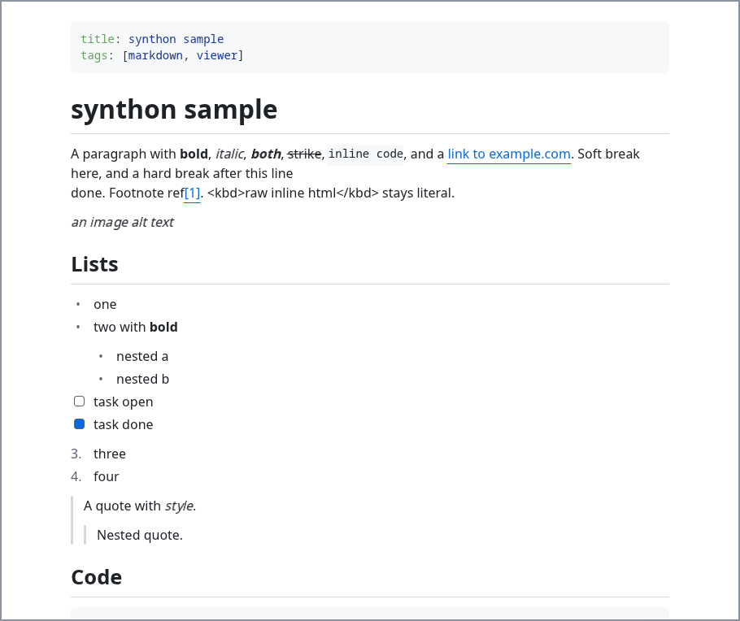
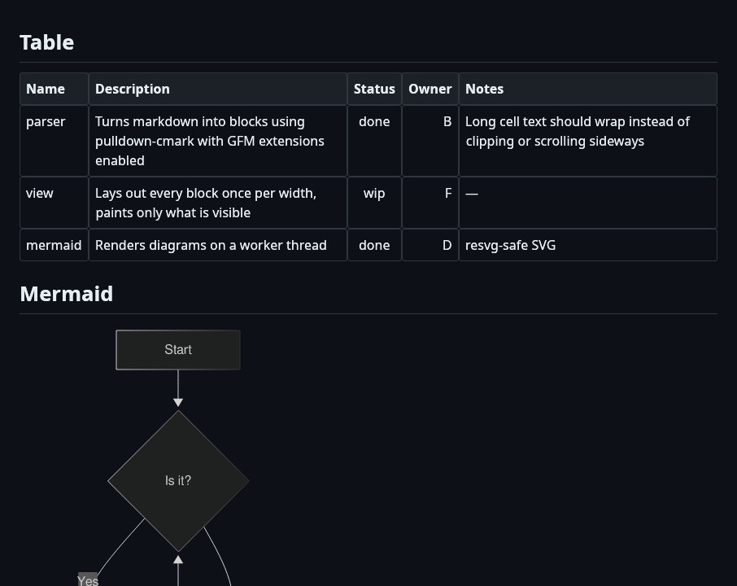
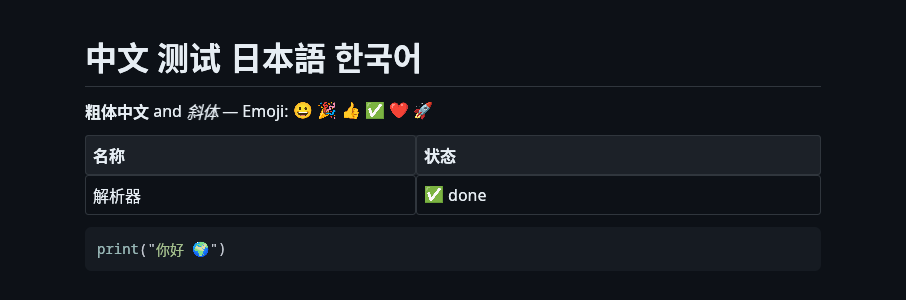

# synthon

A fast, low-memory, read-only Markdown viewer for Linux. You run `synthon file.md` and it opens one document in a native GPU window, with mermaid diagrams, syntax-highlighted code and tables that fit the window.

It's as simple as [glow](https://github.com/charmbracelet/glow), but mermaid diagrams and highlighted code render as real graphics instead of terminal text.

| Light theme | Dark theme, full width | CJK and emoji |
|:---:|:---:|:---:|
|  |  |  |

_Screenshots of the synthon window. Click one to view it full size._

## Features

- **GitHub Flavored Markdown:** headings, emphasis, strikethrough, inline code, block quotes, ordered, unordered and task lists, tables, footnotes, autolinks.
- **Mermaid diagrams:** flowchart, sequence, class, state, ER, gantt, pie, mindmap and more, rendered natively by [merman](https://github.com/Latias94/merman), with no browser or Node.js. Diagrams render on a background thread. If a diagram fails, its source is shown with the error.
- **Syntax highlighting:** 200+ languages via [syntect](https://github.com/trishume/syntect). Long lines scroll sideways inside the code block; the page never does.
- **Tables that fit:** columns are sized to their content and fill the available width, and long cells wrap. This works in full-width mode too.
- **Unicode:** Chinese, Japanese, Korean and colour emoji, using the fonts already on your system.
- **Dark and light themes:** follows your system theme by default; toggle with `t`.
- **Full-width toggle and zoom:** `f` switches between a reading column and the full window, and zoom goes from 50% to 300%.
- **Select and copy:** select text across paragraphs, lists, tables and code, and copy it as plain text. Clicking an `http(s)` or `mailto:` link opens it in your browser.
- **Never blank:** every block on screen is laid out before it is painted, so scrolling never shows an empty frame, and your reading position holds when the window resizes.

## Install

### Prebuilt binary

Download the archive for your architecture (`x86_64` or `aarch64`) from [Releases](https://github.com/initialrise/synthon/releases), then:

```sh
sha256sum -c synthon-*.tar.gz.sha256
tar xzf synthon-*.tar.gz
install -m755 synthon-*/synthon ~/.local/bin/
```

It needs Linux with X11 or Wayland and OpenGL. The binaries are built on Ubuntu 22.04, so they run on glibc 2.35 or newer.

### From source

Requires Rust 1.95 or newer.

```sh
git clone https://github.com/initialrise/synthon
cd synthon
cargo install --path .
```

This installs the `synthon` binary into `~/.cargo/bin`.

## Usage

```sh
synthon README.md                # open a file
cat notes.md | synthon -         # read from stdin
synthon --dark --full-width --zoom 125 doc.md
```

| Option | Meaning |
|---|---|
| `--dark` / `--light` | Force a theme (default: follow the system) |
| `--full-width` | Start in full-width mode |
| `--zoom <50-300>` | Start at this zoom percent (default 100) |

Nothing is saved between runs: every launch starts from these options.

## Keyboard shortcuts

| Key | Action |
|---|---|
| `j` / `↓` | Scroll down one line |
| `k` / `↑` | Scroll up one line |
| `d` / `Ctrl+D` | Half page down |
| `u` / `Ctrl+U` | Half page up |
| `Page Down` / `Page Up` | One page down / up |
| `g` / `Home` | Jump to the top |
| `G` / `End` | Jump to the bottom |
| `t` | Toggle dark / light theme |
| `f` | Toggle full width |
| `Ctrl+=` / `Ctrl+-` / `Ctrl+0` | Zoom in / out / reset (also `Ctrl` + mouse wheel) |
| `q` / `Esc` | Quit |

## Fonts

synthon uses the fonts installed on your system and picks the first one it finds in each group:

| Use | Fonts tried |
|---|---|
| Text | Inter, Noto Sans, DejaVu Sans, Liberation Sans, Ubuntu, then the system sans-serif |
| Code | JetBrains Mono, Noto Sans Mono, DejaVu Sans Mono, Liberation Mono, Ubuntu Mono |
| CJK | Noto Sans CJK, Source Han Sans, WenQuanYi Micro Hei, Droid Sans Fallback |
| Emoji | Noto Color Emoji, Twemoji, JoyPixels (falls back to built-in monochrome emoji) |

Font files are memory-mapped, so a 20 MB CJK font costs only the few MB of glyphs actually used. If CJK text shows as boxes, install a CJK font, e.g. `sudo apt install fonts-noto-cjk`.

## Performance

Measured on a release build, X11 with Mesa OpenGL, using a 1 MB reference document with 10 mermaid diagrams and 50 code blocks:

| | Tiny doc | 1 MB doc |
|---|---|---|
| Launch to first frame | ~80 ms | ~97 ms |
| Peak RSS | ~97 MB | ~141 MB |
| Memory synthon itself allocates | ~29 MB | ~58 MB |

About 65–85 ms of every launch is GPU driver start-up. Parsing, font loading and highlighter warm-up run in parallel with it. About 53 MB of the RSS is the shared, read-only Mesa driver. Run `./bench.sh` to measure on your machine.

## Not in v1

Tabs, file explorer, outline, search, live reload, following links to other `.md` files, images (alt text is shown), LaTeX math, rendering raw HTML (shown as text), and macOS/Windows. See [docs/PRD.md](docs/PRD.md) for scope and design.

## Development

```sh
cargo test                       # unit tests + headless rendering tests
./bench.sh                       # first-frame time and peak RSS (needs a display)
cargo run --release -- fixtures/sample.md
```

| File | Role |
|---|---|
| `src/parse.rs` | Markdown → `doc::Block` tree (pulldown-cmark) |
| `src/view.rs` | Layout, painting, scrolling, fonts, mermaid worker |
| `src/highlight.rs` | Code highlighting (syntect) |
| `src/mermaid.rs` | Mermaid → image (merman + resvg) |
| `src/table.rs` | Column-width algorithm |
| `src/keys.rs` | Key bindings |
| `src/cli.rs` | Arguments and input |

## License

[MIT](LICENSE)
