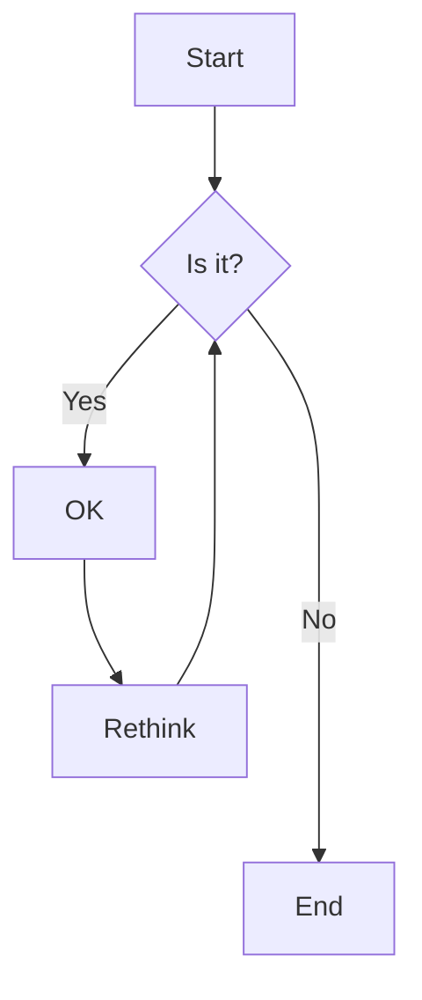
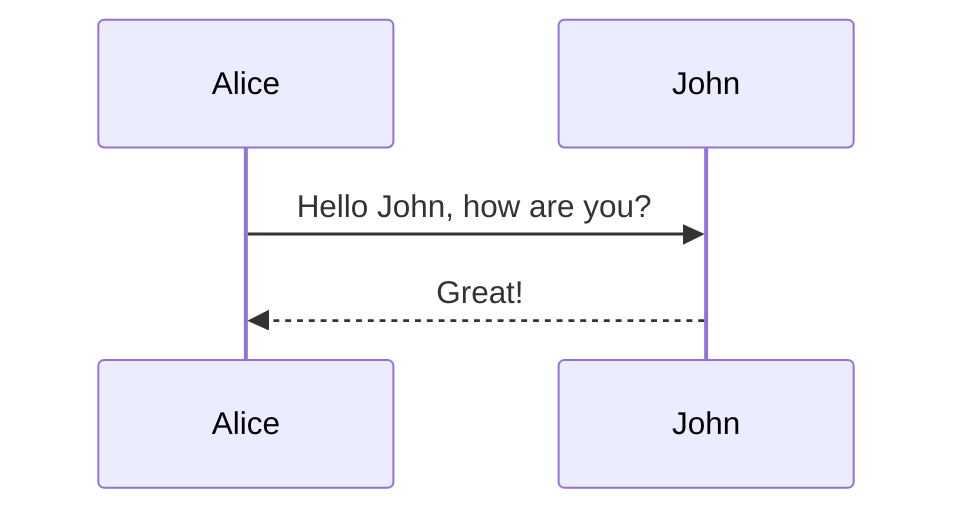

# synthon sample

A paragraph with **bold**, *italic*, ***both***, ~~strike~~, `inline code`, and a [link to example.com](https://example.com).
Soft break here,
and a hard break after this line  
done. Footnote ref[^1]. <kbd>raw inline html</kbd> stays literal.


## Lists

- one
- two with **bold**
  - nested a
  - nested b
- [ ] task open
- [x] task done

3. three
4. four

> A quote with *style*.
>
> > Nested quote.

## Code

```rust
fn main() {
    let xs: Vec<u32> = (0..10).map(|x| x * x).collect();
    println!("{xs:?} — a very long line that should scroll horizontally inside the block only, not the page, keep going, keep going, keep going");
}
```

```python
def hello(name: str) -> str:
    return f"hi {name}"
```

    indented code block

<div align="center">block html shown as text</div>

## Table

| Name | Description | Status | Owner | Notes |
|:-----|:------------|:------:|------:|-------|
| parser | Turns markdown into blocks using pulldown-cmark with GFM extensions enabled | done | B | Long cell text should wrap instead of clipping or scrolling sideways |
| view | Lays out every block once per width, paints only what is visible | wip | F | — |
| mermaid | Renders diagrams on a worker thread | done | D | resvg-safe SVG |

## Mermaid





```mermaid
flowchart TD
  A -->
```

---

[^1]: The footnote text.
